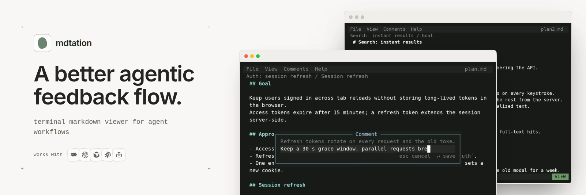
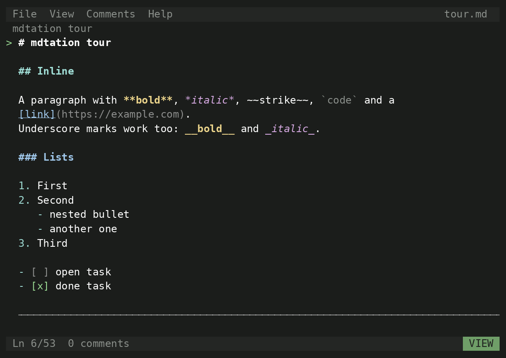

#  mdtation

<div align="center">

**A better agentic feedback flow.**

[](https://www.npmjs.com/package/mdtation)
[](https://github.com/janniks/mdtation/actions/workflows/ci.yml)
[](https://socket.dev/npm/package/mdtation)
[](LICENSE)

*read, breathe, comment, loop*



</div>

A terminal markdown viewer with comments that stick to lines, persist between sessions, and copy as a reference any agent understands.

## The problem

Agents ask for feedback in the worst possible ways.

- Option pickers: A, B or C, and your real answer is "B, but only if the second half of C". There is no box for that, and no way to ask where B came from.
- Itemized lists in a chat thread: Finding F7, section 2.1, recommended (b). The list scrolls away while you type, so you answer from memory.
- A 300-line plan printed into the terminal is read by scrolling a buffer, and your thoughts about line 140 go nowhere.

## The loop

1. The agent writes the plan as a markdown file, not a message, and runs `mdtation plan.md watch --until quit`.
2. You open the file in mdtation, read it full screen, and press `c` on the line (or drag-select the sentence) you disagree with.
3. Each comment lands in the agent's terminal as you make it: line number, section path, quote, and your note.
4. The agent replies with `add --re <id>` or rewrites the file. Both show up on your screen at once, no keypress.
5. You quit, the watcher returns, the agent revises, and you go round once more.

Review the plan, not the chat. Specs, plans, drafts, reviews: the prose your agent writes deserves a real review flow, not a chat reply.

## Install

```sh
npm i -g mdtation
mdtation plans/auth.md
```

The full-screen TUI runs under Bun. Under Node, mdtation renders to stdout instead.

Choose light or dark terminal colors with `"theme": "light"` or `"theme": "dark"` in `mdtation.json`.
Dark is the default; `MDTATION_THEME` overrides the file for a single session.

```sh
MDTATION_THEME=light mdtation plans/auth.md
```

## See it

| Comment on a line | Comment on a selection | Menus and palette |
|---|---|---|
|  |  |  |

## Keys

| key | action |
|---|---|
| `j` `k` | move the caret (wheel and click work too) |
| `c` | new comment on the caret line or selection |
| `e` | edit the comment under the caret |
| `C` | copy the comment as a reference |
| `[` `]` | previous, next comment |
| `a` | show all comments |
| `/` | command palette |
| `m` | hide or show the menu bar |
| `?` | help |
| `q` | quit (`^s` saves checkbox and frontmatter edits first) |

Everything a TUI should have: menu bar, command palette, settings, all mouse ready. View options (color, marks, fences, tables, checkboxes, flow, scroll margin) are remembered.

## CLI

```sh
mdtation plan.md watch                # block; print each comment as it lands (--json for one object per line)
mdtation plan.md watch --until quit   # ...and return when the viewer closes
mdtation plan.md list                 # print live comments as markdown (--since last for the new ones)
mdtation plan.md add "text" --re <id> # reply in a thread, shows inline in the viewer at once
mdtation plan.md mark                 # checkpoint for --since last
mdtation plan.md archive a1 b2        # done with these (restore to undo); d in the viewer does the same
mdtation plan.md prune --older 7d     # remove archived comments for good
mdtation plan.md print                # render to stdout and exit
mdtation plan.md status               # print the data dir
mdtation skill                        # print the agent skill
```

Comments live in one json per file under `$MDTATION_HOME`, `$XDG_DATA_HOME/mdtation`, or `~/.mdtation`, keyed by absolute path, with an append-only `.events.jsonl` beside it that `watch` tails.
Set `MDTATION_AUTHOR` so the agent's replies carry its name.

Tell your agent: "Run `mdtation skill` and follow it for plans/auth.md."

## License

MIT
